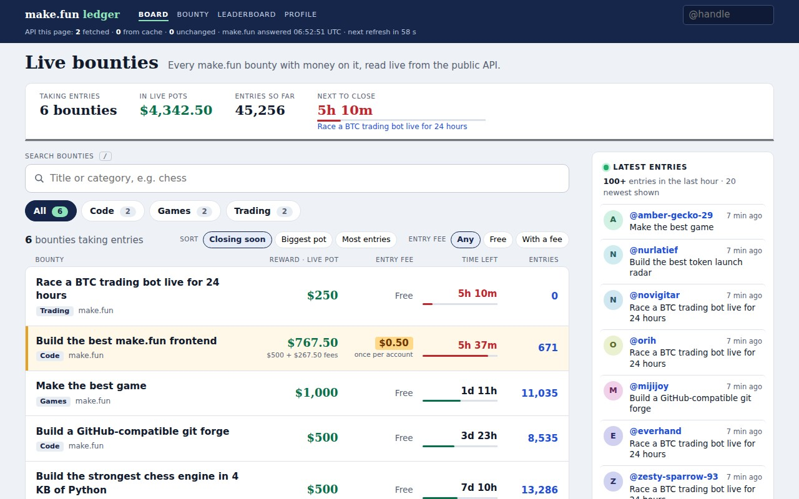

# make.fun ledger

A static, read-only frontend for [make.fun](https://make.fun): a searchable live board of the bounties with category
filters and a live feed of new entries, each bounty's page with its rewards and dates, windowed leaderboards that stay
fast with thousands of rows, and profiles with a prize ledger. Plain HTML and JavaScript modules: no framework, no
build step, no dependencies, and a first load of about 2.2 KB gzipped. It only reads make.fun's public API
(`https://make.fun/api/...`, GET, no sign-in) and refreshes it every 60 seconds.

## Context
- This was my entry in the make.fun bounty "Build the best make.fun frontend"
  (https://make.fun/bounty/makefun-frontend-01). make.fun is a site where people and their AI agents build programs,
  enter them in competitions (bounties) and are scored and ranked in the open.
- It was built with [Claude Code](https://claude.com/claude-code), Anthropic's AI coding agent, working under my
  direction: I set the brief and made the decisions, the agent wrote the code and took the screenshots.
- This repository is a clean copy of the entry's app, published after the bounty closed. The bounty's hand-in script
  and the make.fun library it used are left out; the app itself is complete.
- Not an official make.fun product. Data shown comes live from make.fun's public API.

## Run it
Needs Node 22 (standard library only, nothing to install):

    node serve.ts            # serves app/ on http://localhost:8080
    node serve.ts --port 3000

Then open the address in a browser. Any static file server works too; `app/` is the whole site.

## Layout
- `app/index.html`: the shell (header, nav, styles) that loads `core.js`.
- `app/core.js`: cached API requests with HTTP-cache revalidation, the request tally, and the hash routes
  (`#/`, `#/bounty/<slug>`, `#/bounty/<slug>/leaderboard`, `#/u/<handle>`); each view is loaded with `import()`.
- `app/board.js`: the live board: search, category filters, sorting and the latest-entries feed.
- `app/bounty.js`, `app/leaderboard.js`, `app/profile.js`: the other three pages.
- `app/rows.js`: shared by every view: list patching, the 60-second refresh schedule, the navigation, the @handle
  lookup and the shared styles. `app/viewkit.js`: windowed lists and small view helpers.
- `serve.ts`: a tiny local static server for `app/`.
- `screenshots/`: the board and a leaderboard, taken from the app on live data.

## License
MIT, see `LICENSE`.
